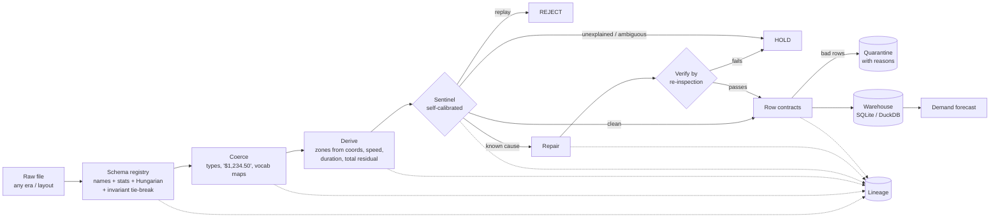

# DriftGuard

**An ingestion pipeline that doesn't just notice bad data. It works out *why* the data is bad, repairs what it safely can, holds what it can't, and measures what that's worth to a downstream model.**

Built for 15+ years of NYC taxi trip records (1B+ rows). Over that time the column names, encodings and units in these files kept changing.

```
$ python -m driftguard demo
  2024-01-16  injected=unit_km            -> ACCEPTED_REPAIRED  unit_change        (÷1.609, verified)
  2024-01-18  injected=clock_shift        -> ACCEPTED_REPAIRED  clock_shift        (−5h, verified)
  2024-01-20  injected=duplicate_batch    -> REJECTED           duplicate_batch
  2024-01-22  injected=obfuscated_headers -> ACCEPTED           (columns identified from their values alone)
  2024-01-24  injected=column_swap        -> ACCEPTED_REPAIRED  column_swap        (tip ↔ tolls)
  2024-01-26  injected=subtle_scale       -> ACCEPTED           distribution_drift (unexplained, flagged for a human)
```

> **Real-data results:** when this repository is uploaded to GitHub, the `real-data-study` workflow automatically downloads real NYC TLC files, runs the study on GitHub's servers, and commits the results to [`results_real/`](results_real/), including `report_real.html`. Re-run it any time from the **Actions** tab (choose *quick* or *full*).

## Headline results

These numbers come from synthetic data with known ground truth: 5 seeds for E1 and E2, 3 seeds for E3. Open `results/report.html` for the full report.

| | |
|---|---|
| Injected faults detected (10 detectable types, 100 faults) | **100%** |
| …with the **correct cause** named | **100%** |
| False alarms on clean batches | **1.2%** (2 / 160) |
| Auto-repaired batches vs. ground truth (max KS distance) | **≤ 0.006** |
| Columns identified across 6 header eras, real names | **100%** (545 / 545) |
| Columns identified with **meaningless headers** (`col_00`…) | **97%** (530 / 545) |
| Silent column mis-mappings, any configuration | **0** |
| Forecast damage prevented at a 40% fault rate | **94%**: naive WAPE 44.9% → DriftGuard 37.8% (perfect data: 37.4%) |

## What's new here

Most data-quality tools give you rules ("fare ≥ 0") or drift alarms ("KS = 0.41 on `trip_distance`"). An alarm still leaves a person to work out what happened. DriftGuard closes that gap in four ways:

1. **Dual-evidence schema inference.** Each incoming column is scored against every canonical column by **name** (aliases, abbreviation expansion, fuzzy matching) and by **statistical fingerprint** (quantiles, cardinality, integer and zero shares, categorical vocabulary). The assignment is solved globally with the **Hungarian algorithm**, so one raw column can never be claimed twice. A column called `col_07` gets recognised as `fare_amount` because its values look like fares.
2. **Invariant-guided disambiguation.** Some columns are statistically identical, like pickup vs. dropoff timestamps. When two assignments are near-ties, the registry tries both and keeps the one that satisfies cross-field rules: dropoff comes after pickup, speeds are plausible, totals add up. If it still can't tell, it **flags the columns instead of guessing**. Result: zero silent errors, and 41% fewer columns sent to a human.
3. **A sentinel that names causes.** Drift is tested against specific, *repairable* hypotheses:
   - **Unit change:** does `batch ÷ k` match the reference for a known factor k (1.609 for miles to km, 100 for dollars to cents)?
   - **Clock shift:** does the hour-of-day profile match the reference after a circular shift of L hours?
   - **Column swap:** does column A now look like reference B, and B like A?
   - **Replays:** whole batches or individual rows that were already delivered, caught by row hashing.

   Drift that matches no known cause is **held for a human**, never "fixed".
4. **Repair, then verify.** Every repair is checked by re-inspecting the repaired batch, so a wrong fix gets held instead of loaded. Raw data is never modified, and every step writes a lineage record with row counts, content digests, timings and decisions.

The thresholds **calibrate themselves**. During a warm-up window of trusted batches, the sentinel measures how much its own statistics vary from day to day and sets per-column thresholds at mean + 5σ, with sensible minimums.

## Architecture



## Quick start

```bash
pip install -e ".[dev]"          # pandas, numpy, scipy, scikit-learn, pyyaml
pytest -q                         # 27 tests
python -m driftguard demo         # 28-day run with injected faults -> out/demo.sqlite + lineage JSON
python -m driftguard bench        # all three experiments (~4 min) -> results/
python -m driftguard report       # -> results/report.html
```

## Running on real data: one command

```bash
pip install -e ".[real]"                                     # adds pyarrow (reads the TLC Parquet files)
python scripts/run_real_study.py --selftest                  # 30 s, no internet: checks your setup
python scripts/run_real_study.py --download --quick          # ~15 min: 2 months sampled, 3 historical layouts
python scripts/run_real_study.py --download                  # full: Mar–Jun 2023 + 6 historical layouts
```

The full run downloads 10 monthly files from the official TLC mirror into `data/raw/`. The historical months are large, so expect a few GB and plenty of time on a slow connection. Processing takes roughly 5–15 minutes and needs about 4 GB of RAM. The study runs four parts:

| Study | Question | Output |
|---|---|---|
| **A · historical layouts** | Do 2009–2021 files map correctly by name? With headers scrambled, do the values alone give the same mapping? | `A_eras.csv`, `A_mapping_rows.csv` |
| **B · real quality** | What do real rows violate? Which real days does the sentinel flag, and why? | `B_real_batches.csv`, `B_quarantine_reasons.csv`, `B_findings.csv` |
| **C · faults on real batches** | Detection and correct-cause rate on top of real noise; alarm rate on real clean days | `C_faulted_batches.csv` |
| **D · downstream** | Demand forecast (265 zones) trained on the naive vs. DriftGuard warehouse | `D_downstream.csv` |

Everything lands in `results_real/` (including `report_real.html`) and is zipped as **`results_real.zip`**. It's small (KBs, no raw data), so share that file.

Every flagged real day in study B needs a human verdict: was it a real-world event (holiday, storm, rule change) or a data problem? Making those calls, and writing them up, is the research part of this project.

For a single file you can also run `python -m driftguard map FILE --reference REF` or `python -m driftguard ingest FILES --db out/tlc.duckdb`.

## Project layout

```
driftguard/
  synth.py          generator with ground truth + 6 historical header eras
  profiles.py       column fingerprints, numeric repair, similarity scores
  registry.py       schema inference (names + stats + Hungarian + invariants), mapping memory
  transform.py      coercion to canonical types, vocab maps, zone resolver, invariants
  sentinel.py       self-calibrating drift checks + cause attribution
  contracts.py      row-level rules -> quarantine with reasons
  pipeline.py       map -> coerce -> derive -> inspect -> repair -> verify -> contracts -> load, + lineage
  warehouse.py      Memory / SQLite / DuckDB backends
  faults.py         12 labelled fault types
  forecast.py       downstream demand model (HistGradientBoosting, Poisson loss)
  benchmarks.py     experiments E1–E3
  report.py         self-contained HTML report (inline SVG, colour-blind-safe, dark mode)
  config/           canonical_schema.yaml, contracts.yaml
experiments/run_all.py   ·   scripts/download_tlc.py   ·   tests/   ·   docs/paper.md
```

## Design decisions (and their trade-offs)

- **Hold, don't guess.** Under meaningless headers, the registry identified every modern-era column correctly, yet still held 70% of those batches. A near-tie it couldn't fully settle (for example `payment_type` vs `rate_code`) was enough to trigger a hold. That's a deliberate trade: one human approval stores the mapping under the file's fingerprint, and every later file with that layout is mapped automatically.
- **Auto-repair is a policy, not a default truth.** `Policy(repair_units=False, …)` turns any repair into a hold. Repairs only run when a specific cause is attributed *and* the re-inspection passes.
- **Drift ≠ error.** An 8% fare increase is flagged, never repaired, because statistically it looks the same as a real tariff change. Only a person or an external signal can tell them apart.
- **Known-missing beats silently-missing.** Held days become `NaN` in the warehouse partition map, not zeros. That alone accounts for a large share of the downstream improvement.

## Limitations

- Results are on synthetic data. The generator is realistic but simpler than the real thing, and real-data validation is the next step.
- The rolling reference absorbs slow drift ("boiling frog"). A frozen long-term baseline alongside it would catch gradual decay.
- Under meaningless headers, constant-valued columns whose value changed between eras (e.g. `improvement_surcharge`: 0.30 vs 1.00) can't be identified from values alone. They're reported as unmapped, not mis-mapped.
- Schedule-dependent columns (`extra`) get wide thresholds, because the reference pools weekdays and weekends.

## Authorship and use of AI tools

DriftGuard is my project. The problem comes from my industry work at Maruti Suzuki, where I reconciled undocumented schema variants across 2,000+ test-bench files and saw how silently bad data degrades models. I built it with substantial help from generative AI tools for code and documentation. I reviewed the generated material, ran and validated the experiments, and I am responsible for the design choices, results and conclusions reported here.

— Harshita Pandita

